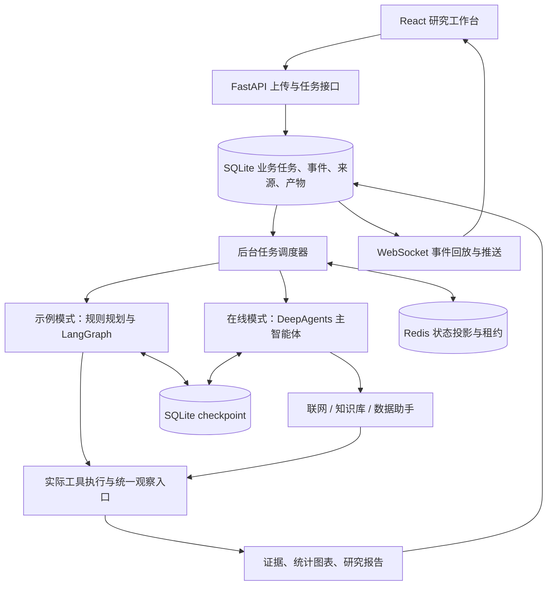

# 实现结构与执行边界

应用为本地单用户工作台，一个后端进程负责有限并发任务。前端可由 Vite 开发服务器代理接口，也可在构建后由 FastAPI 同端口提供。

| 模块 | 所在位置 | 职责 |
| --- | --- | --- |
| 配置 | `backend/app/config.py` | 读取 RESEARCH_ 配置，检查在线服务缺项 |
| 业务存储 | `backend/app/storage.py` | 任务、事件、证据、产物、工具记录、Redis 待同步记录 |
| 上传与样例 | `backend/app/ingestion.py` | 解析文件、数据概况和样例幂等加载 |
| API | `backend/app/main.py` | 数据与任务接口、WebSocket、文件下载、静态前端 |
| 调度与恢复 | `backend/app/tasks.py` | 实例锁、并发、执行预算、取消、重启扫描与报告落盘 |
| Redis 状态 | `backend/app/redis_state.py` | 版本化任务投影、状态索引和 owner 租约 |
| 研究运行 | `backend/app/engine/runner.py` | 两种模式的图构建、checkpoint 读取与续跑 |
| 九个工具 | `backend/app/engine/tools.py` | 真实资源读取、受限统计、图表与证据登记 |
| 缓存 | `backend/app/engine/cache.py` | 精确与余弦匹配、业务范围过滤、有效期和向量版本隔离 |
| 观察入口 | `backend/app/engine/middleware.py` | 工具与模型调用预算、事件、耗时和失败采集 |

示例模式按问题和附件做规则路由，并实际执行读取文件、统计、绘图和 checkpoint。其离线网页来自 samples，不访问实时互联网；字符特征哈希用于展示检索与余弦匹配流程，不是神经 embedding 的效果证明。

在线模式构建一个 DeepAgents 主智能体和三个助手，通过工具权限隔离分工。主智能体决定委派与有限补查；工具证据、产物与最终引用由应用核验。实际模型是否正确使用工具、能否输出满足要求的报告，需要用所配置的服务另行验证。

业务任务以 SQLite 为持久化依据，状态变化写入待同步记录后投影到 Redis。Redis 更新拒绝旧版本覆盖新版本；重启可从持久化任务重建运行状态。该设计不宣称跨库原子事务。

checkpoint 保存图执行状态。恢复时继续使用原 task_id/thread_id，读取已有状态；显式重试则新建任务。未持久化的外部请求可能重复执行，最终产物按业务键去重，不能把恢复功能称为所有外部调用“恰好一次”。

事件先保存再展示，工具日志、页面过程与指标共享任务标识。页面缓存命中比例的分母是进入缓存流程的查询工具调用（`search_web`、`fetch_page`、`extract_page_tables`），由 `cache_lookups` 返回；其他工具与框架内置工具不计入此分母。精确命中和语义命中分别记录。token 用量只累加服务实际返回的数值，并报告用量覆盖率，不能把缺失用量当作零。

`scripts/evaluate_cache.py` 使用预先固定的查询序列，专项运行关闭前置精确缓存；另做只读精确探针。它复用实际搜索适配器，在命中路径包含当前任务证据登记，并对同一批正确命中逐项直连接口测量。示例结果只表示字符哈希和离线网页的流程；线上查询测试与完整智能体任务评测的边界见 [CACHE_EVALUATION.md](CACHE_EVALUATION.md)。
