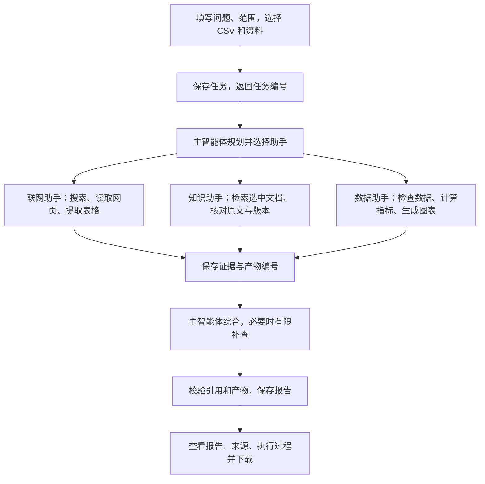

# 研究流程与本地演示

这个项目把一个研究问题推进为带来源的报告。用户提供问题、研究范围，以及按需选择的经营 CSV 和知识资料；系统规划工作、调用工具、保存证据，最后生成报告和实际统计图表。

## 一次完整研究怎样进行

以“分析 2026 年 1—3 月咖啡用品销售变化，结合产品资料与公开市场信息，给出下月选品建议”为例：

1. **输入与任务创建。** 选择日期、品类等范围，并勾选本次允许使用的资料。后端先保存任务和原始输入，再交给有并发上限的后台执行器。关闭浏览器不会取消任务。
2. **规划与委派。** 在线模式由 DeepAgents 主智能体决定使用哪些助手、先后依赖和补查；三个助手使用隔离的上下文与工具权限。当前配置可以让四个角色共用一个模型，分工由职责和工具决定。
3. **获取事实与计算。** 联网助手返回公开来源；知识助手只检索本任务选中的文档；数据助手实际读取 CSV，先检查字段与数据质量，再由程序统计和绘图。模型不执行任意 Python 或 SQL。
4. **证据汇总。** 工具返回摘要、证据编号和产物编号。网页、资料与计算结果保存在任务记录中；同一网页的正文变化会产生对应证据版本。主智能体据此综合报告，缺少证据时说明限制。
5. **结果校验。** 应用检查引用编号、图表链接是否属于当前任务，并保存 Markdown、统计 JSON/CSV 和 PNG。引用可定位只证明来源存在，结论是否受原文支持仍需抽查。
6. **前端展示。** 报告、来源、研究计划和实际执行事件都来自后端记录。WebSocket 提供实时更新，刷新或重连后通过事件游标与 HTTP 恢复状态，不能把连接心跳当成研究完成。

纯数据问题可以只委派数据助手；公开资料问题可以不上传 CSV；综合问题按需要组合助手。九个工具是系统的可用能力，不要求每个任务都调用全部九个。

## 在页面上操作

按 README 启动后打开 `http://127.0.0.1:8000`，先看“服务配置”。在线模式需要模型、搜索、Embedding 和支持 Search 向量查询的 Redis 都就绪；连接成功与具备向量检索能力会分别显示。

1. 在“资料与数据”点击“加载示例资料”，或上传自己的 CSV、TXT、Markdown、可提取文本的 PDF。
2. 点击“新建研究”，选择模式，填写研究问题，勾选本次资料与数据，并设置日期范围。示例 CSV 可设置 `2026-01-01` 至 `2026-03-31`，品类“咖啡用品”，地区留空。
3. 提交后观察研究计划与“执行过程”，确认实际调用了哪些助手和工具。纯数据问题可使用：“仅根据上传 CSV 计算销售额、订单量和月度变化，不联网、不查询知识库”。
4. 完成后查看“研究报告”，核对程序统计、图表、公开资料和建议；在“证据来源”抽查引用，在“运行观察”查看工具次数、耗时、成功率和缓存命中。
5. 下载 Markdown 报告。刷新页面，确认任务和执行事件仍存在。执行中可明确取消；对失败或已取消任务点击重试会创建新任务。

## 示例数据的核对口径

样例全部有明确的模拟标识。19 行商品明细对应 16 个去重订单；销售额 3900 元，退款 180 元，净销售额 3720 元。三个自然月的销售额分别为 900、1200、1800 元，二月环比约 33.33%，三月环比 50%。净销售额不等于利润。

示例模式使用规则规划、离线虚构网页和实际文件计算，不调用真实模型或搜索。在线模式使用真实模型、搜索和向量服务，但选用模拟经营 CSV 时，经营结论依然只能解释这份模拟数据，不能推导真实店铺或整个行业。

## 恢复与缓存如何参与

业务任务、证据、产物和有序事件由 SQLite 持久化；LangGraph 执行状态另存 checkpoint。Redis 保存运行元数据、状态索引和执行租约。服务重启时扫描非终态任务，继续使用原任务编号和图线程，从已保存执行边界恢复；未持久化的外部请求仍可能重复执行和收费。

外部查询先查有效的精确缓存，再在允许语义复用时生成向量并做余弦相似度查询。复用还要符合日期、地区、实体、意图和服务版本等约束。命中的原始查询结果会重新登记为当前任务的证据；最终报告不会直接作为另一项研究的现成答案。

本轮实际通过的项目、在线恢复证据和缓存测量结果以 [VALIDATION.md](VALIDATION.md) 为准。单元测试、离线演示和模型基础连接成功不能替代完整在线研究验收；缓存命中加速也不能替代整项研究耗时。
