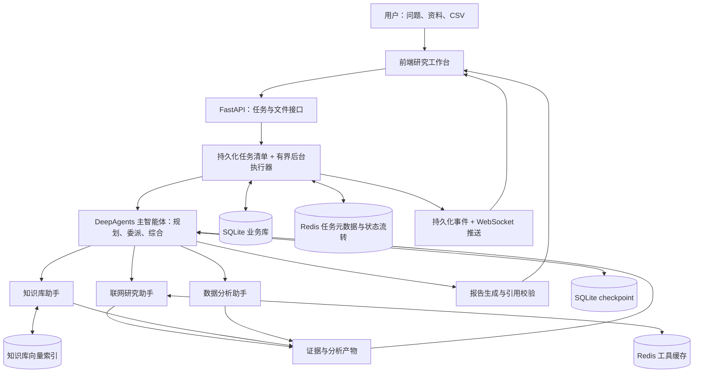

# 多智能体深度研究系统：项目实现方案

编写日期：2026-10-29。依据用户提供的项目描述截图与框架官方文档整理；已按截图逐项复核调整。

本文保留原始实施设计。2026-10-30 已完成本地可运行版本；实际能力和验证边界见 [README.md](README.md) 与 [docs/VALIDATION.md](docs/VALIDATION.md)。在线服务及截图性能数字仍待配置后验证。截图没有给出原项目源码、数据集、工具清单与测试记录，下面的业务场景、接口、工具拆分和验收标准均为本项目的实现选择。

最终交付以截图中的完整能力为准。分阶段开发用于降低实施难度，不能把中间阶段当成全部完成。截图中的项目经历时间不作为本项目的实际开发起始时间。

| 图片要求 | 本方案的最终实现与验收要求 |
| --- | --- |
| 电商领域长链路研究 | 自动完成任务规划、信息检索、数据分析、报告生成；支持按问题选择研究路径 |
| Python、DeepAgents、LangGraph、LangChain、FastAPI、Redis、SQLite、React | 保留全部技术栈，前端确定为 React + TypeScript；pandas 等作为辅助库 |
| Orchestrator-Workers：1 主智能体 + 3 领域助手 + 9 外部工具 | 主智能体负责规划和动态委派；联网、知识库、数据助手各配置 3 个实际可调用工具；不把框架内置工具计入这 9 个 |
| 上下文隔离 | 助手使用独立上下文和工具权限，向主智能体返回摘要、结果与证据定位 |
| SQLite checkpoint + lifespan 自动恢复 | 持久化图状态，服务重启后自动扫描并恢复符合条件的中断任务 |
| Redis 任务级元数据与状态流转 | 必须维护任务元数据、运行状态、状态索引与执行租约；SQLite 保留持久化记录用于恢复和对账 |
| Middleware + WebSocket + Logger/Monitor/Metrics | 中间件覆盖主智能体和助手的工具调用；采集频次、耗时和成功率；异步执行过程实时展示并覆盖完整生命周期 |
| Embedding + Redis 语义缓存 | 缓存可复用的外部 API 查询结果，显式使用余弦相似度或其等价距离，并校验业务范围和有效期 |
| 连续任务分布下平均 30 倍、命中率 30%—50% | 作为复现实验目标；提前固定任务分布、指标分母与测量方法，保留实际结果，达到后才能作为已实现成绩 |

**1. 先确定一个能够完整演示的业务场景**

系统定位为“电商领域多智能体深度研究系统”，支持品类研究、竞品比较、经营分析等问题。“电商品类研究助手”作为首个完整演示场景，不能把系统限定为只能分析一种品类或必须先上传 CSV。示例中，用户上传一家店铺的订单 CSV、产品说明与经营资料，输入：

> 分析这家店铺近三个月咖啡用品的销售变化，结合公开市场信息，解释主要变化，并给出下月选品与运营建议。报告需要标注来源和数据限制。

输入包括研究问题、明确的起止日期、地域或平台范围；知识库文件和经营数据按问题需要提供。纯公开资料研究可以只检索公开信息；涉及店铺经营数值时必须有相应数据。输出包括 Markdown 报告、按任务需要生成的统计表与趋势图、引用来源及研究过程记录。

销售额、订单量、客单价、退款率等必须来自程序计算；行业信息来自实际检索；经营建议由模型综合这些证据形成。三者在报告中分别标明。

可以先用固定规则生成模拟店铺 CSV，但页面、数据说明和报告都要标注“模拟经营数据”。公开网页不能自动提供某店铺的真实销量，也不能用模拟店铺数据推导整个行业的增长率。

部署范围先定位为本地、单服务进程、少量研究任务的演示系统；最终仍须包含截图的 1 + 3 + 9、动态调度、恢复、可观测性和语义缓存。PDF 导出、多租户、分布式调度和开放式代码执行可后续再做。

**2. 技术栈如何分工**

| 技术 | 本项目中的职责 |
| --- | --- |
| Python / FastAPI | 上传文件、任务接口、后台执行器、报告下载、实时事件连接 |
| DeepAgents SDK | 主智能体、任务规划、三个专业助手、上下文管理 |
| LangChain | 模型与工具接口、结构化结果、中间件 |
| LangGraph | 智能体运行状态、checkpoint、恢复执行、执行事件 |
| SQLite | 业务任务清单、来源与产物元数据；另一个文件保存图 checkpoint |
| Redis | 任务级元数据、运行状态及状态索引、执行租约、语义缓存；采用支持向量搜索的部署 |
| React + TypeScript | 任务创建、过程展示、来源查看、报告与指标页面 |
| pandas / 绘图库 | 确定性的经营指标计算与图表生成 |

DeepAgents 建立在 LangChain 和 LangGraph 之上，这三者形成一套上下衔接的能力。主路径采用 DeepAgents SDK 自托管，不必同时再维护一套独立的智能体调度循环。参考：[DeepAgents 官方概览](https://docs.langchain.com/oss/python/deepagents/overview)。

前端确定使用 React + TypeScript，与截图的 React 技术栈保持一致。

实际编码前锁定相互兼容的依赖版本，再跑通工具调用、子智能体、异步 checkpoint 和流式事件的最小样例。不要混用不同版本教程里的接口。

**3. 整体架构与一次研究的执行路径**



执行路径建议如下：

1. 校验输入，确认时间范围、文件是否已解析、数据字段是否满足分析需要。
2. 先创建持久化任务并返回任务 ID，再由后台执行器开始研究。
3. 主智能体生成可展示的计划，按任务需要委派助手。
4. 助手实际调用工具，返回简明结果以及可查证的来源 ID、数据 ID、产物 ID。
5. 主智能体检查证据缺口，必要时做一次补充检索。
6. 根据证据生成报告，校验引用能否解析、图表是否存在、关键数字是否有计算来源。
7. 保存报告和任务终态，前端读取结果；失败则展示具体阶段和可理解的原因。

开发时可以用固定执行顺序联调工具，但最终验收必须启用按问题选择助手、按依赖安排执行、根据证据缺口有限补查的动态调度。固定流程仅作为开发基线。

**4. 一个主智能体、三个助手具体做什么**

| 角色 | 输入 | 执行内容 | 返回内容 |
| --- | --- | --- | --- |
| 主智能体 | 问题、范围、可用资料、执行预算 | 拆解子问题、决定委派对象、判断缺口、综合结论 | 研究计划、最终报告、限制说明 |
| 联网研究助手 | 子问题、日期、地区、来源要求 | 检索公开信息、读取网页、提取相关事实 | 事实摘要、来源 ID、时间信息 |
| 知识库助手 | 子问题、知识库 ID、相关实体 | 检索产品说明和业务文档，定位原文 | 文档 ID、片段 ID、页码或段落、摘要 |
| 数据分析助手 | 数据集 ID、时间范围、指标口径 | 检查数据质量、真实统计、生成图表 | 指标、计算口径、表格和图表 ID |

四个角色可以使用同一个支持工具调用的模型。角色差异主要体现在职责、上下文和工具权限，无需先接四个不同模型。

所谓动态调度，应能观察到：纯数据问题只调用数据助手；综合研究按需要调用多个助手；发现缺少价格因素证据时追加相关搜索。无需为了这个目标动态创建新角色。

主智能体输出可检查的计划项，包括 subtask_id、worker_type、question、depends_on 和 expected_output；执行层校验助手白名单、依赖和预算。由 DeepAgents 主智能体的委派入口执行计划，应用层负责约束和记录，不另建一套互相冲突的智能体循环。助手遇到数据不足或检索缺口时把问题返回主智能体，由主智能体决定改计划或补查。

建议的初始限制是：最多 6 个子任务、最多 2 个并发助手、最多 1 轮补查，并配置总运行时间、模型调用次数和工具调用次数上限。这些是待调优的工程参数，必须在执行器或中间件中强制执行，不能只写在提示词中。

主智能体应只接收助手的摘要、关键结果和引用 ID。网页全文、文档片段和大表格保存在任务目录或证据库中，需要时再定位读取。隔离上下文能减少无关中间内容进入主对话，但不会自动保证事实正确。参考：[DeepAgents 子智能体](https://docs.langchain.com/oss/python/deepagents/subagents)。

最终配置固定为 1 个主智能体和 3 个专业助手。实现时检查并禁用所锁定版本可能自动加入的 general-purpose 助手；三个助手不再递归创建新角色。各专业助手显式配置自己的工具和统计中间件，不能假定会继承主智能体的所有自定义配置。

**5. 九个外部工具的落地清单**

最终实现下列 9 个由模型通过 tool 接口调用的外部能力，并逐项验证实际执行。截图没有列出原项目的具体工具名，因此该清单是本方案的实现选择，不能声称还原了原始清单。“外部”以智能体边界为准：包括互联网 API、知识库资源和数据处理能力，其中一部分可在本地服务或进程内实现；不能据此声称接入了九家第三方 API。框架内置的规划、委派和文件工具另计。

| 助手 | 工具 | 实现内容 |
| --- | --- | --- |
| 联网 | search_web | 调用一个搜索服务，返回标题、URL、摘要和来源信息 |
| 联网 | fetch_page | 获取网页并提取正文，保存来源、抓取时间和正文快照 |
| 联网 | extract_page_tables | 从已读取页面提取结构化表格，保留表头、单位和原文定位 |
| 知识库 | search_knowledge | 对指定知识库进行向量检索，返回相关片段与引用 ID |
| 知识库 | read_chunk | 读取指定片段及必要的相邻上下文 |
| 知识库 | get_document_metadata | 获取文档标题、版本、日期、适用范围等信息 |
| 数据 | inspect_dataset | 返回列名、类型、日期范围、缺失值与样例 |
| 数据 | aggregate_metrics | 按允许的维度、指标、过滤条件执行 pandas 统计 |
| 数据 | create_chart | 根据已保存的统计结果生成趋势图或对比图 |

联网工具实际访问搜索服务或真实网页；知识库工具读取向量索引、原文片段和文档元数据；数据工具读取实际数据集并执行统计及绘图。extract_page_tables 接收 URL 或已保存的网页资源 ID，输出必须能定位原始页面。提示词、结果格式化和框架内置委派能力不计入这九项。

开发时可以先打通其中六项进行联调，但最终必须实现并验证表中的全部九项，不能用空实现、模拟成功响应或重复包装凑数。报告保存、任务更新和文件上传由应用层完成。

工具统一返回 status、summary、evidence_ids、artifact_ids、error_code 等字段。每个工具都应校验参数，限制结果大小，设置超时，并仅对可恢复错误做有限重试。

网页与上传文档中的文字按资料处理，不能覆盖系统规则。网页读取应限制协议、目标地址、响应体积与重定向，避免工具随意访问本机或内部地址。数据工具第一版只开放受限统计操作，不执行模型任意生成的 Python 或 SQL。

**6. 知识库、数据分析和报告如何形成可信闭环**

知识库上传流程：文件保存 → 正文解析 → 按标题或段落切块 → 生成 embedding → 写入向量索引，同时保存文档版本、片段原文和位置。块大小和重叠范围用代表性资料验证后确定。

采用支持 Search/vector query 的 Redis 部署，保存知识库与语义缓存的向量索引，使用独立索引和命名空间。原始文档及片段保存在文件系统和 SQLite，向量索引可重建。不能默认任意旧版基础 Redis 都支持向量搜索。

数据集建议字段包括 order_id、order_date、product_id、category、quantity、paid_amount、refund_amount，并明确字段含义与数据粒度。若一个订单有多行商品，订单量应按订单 ID 去重，不能直接用行数代替。

先定义清楚销售额、退款金额、净销售额和客单价口径，再编写统计工具。环比的前期值为零、日期覆盖不完整、退款跨期时，输出明确限制，不生成无意义百分比。

每条事实或统计结果对应一条证据记录：evidence_id、source_type、来源位置、采集时间、适用日期、相关实体和必要的计算口径。网页记录 URL 和可获取的发布日期；文档记录文件与页码或段落；统计记录数据集版本、过滤条件和指标定义。

报告建议包含研究范围、数据概况、关键发现、图表、公开资料信息、经营建议、限制和参考来源。引用校验第一版只保证来源存在且能定位；“来源是否真正支持这条结论”仍需要抽样人工核验，不能把引用完整率称为事实准确率。

**7. 持久化与中断恢复应如何实现**

| 状态类型 | 存储位置 | 保存内容 |
| --- | --- | --- |
| 业务任务 | app.sqlite | 原始输入、task_id、thread_id、状态、attempt、错误、产物位置 |
| 图执行 | checkpoints.sqlite | LangGraph checkpoint，由官方 saver 管理其表结构 |
| 运行协调与状态流转 | Redis | 任务级元数据、运行状态、状态索引、执行 owner、租约和状态版本；可由持久化记录重建 |
| 文件产物 | data/tasks/任务ID/ | 网页快照、证据、统计表、图表和报告 |

task_id 是业务标识，thread_id 是图恢复标识；第一版可以一一对应。恢复时保留 thread_id，重新做一次研究则创建新任务，避免混入旧上下文。

Redis 的任务管理是必做模块：任务 Hash 至少保存 task_id、thread_id、status、phase、current_agent、attempt、owner、heartbeat_at、updated_at、version；状态索引用于定位 queued、running、recovering 等任务。通过统一 TaskStateService 管理合法状态变更，例如 queued → running → succeeded/failed，失效运行任务进入 recovering，收到取消则进入 cancel_requested → cancelled。

TaskStateService 先将带版本的状态变更持久化到 SQLite，再更新 Redis 元数据和状态索引；Redis 侧采用原子操作，拒绝旧版本覆盖新版本。Redis 更新失败时保留可重试的同步记录，后台对账补齐。这样 Redis 实际维护运行时元数据与状态流转视图，同时 SQLite 提供重启恢复所需的持久化依据，不假定两个存储能跨库原子提交。

checkpoint 保存的是图状态。恢复依赖已经写入的步骤和执行边界，无法还原被终止的 Python 调用栈或正在进行的网络请求。异步执行应使用适配的 AsyncSqliteSaver。为验证崩溃恢复，可以先选择同步持久化模式，接受额外写入开销。参考：[LangGraph Checkpointers](https://docs.langchain.com/oss/python/langgraph/checkpointers)。

应用恢复流程：

1. FastAPI lifespan 初始化数据库、checkpointer 和 Redis，启动自动恢复扫描与后台调度；Redis 元数据缺失时从 SQLite 重建。
2. 先对账 cancel_requested：如果没有有效执行者，则转为 cancelled，不再执行。再从 SQLite 查询 queued、以及执行已失效的 running/recovering 任务，检查取消状态和有效租约。
3. 领取任务并增加 attempt，保证同一 thread 同时只有一个有效执行者。
4. 有未完成 checkpoint 时从保存状态继续；可恢复的非终态任务若没有 checkpoint，则根据持久化原始输入重新开始，或在输入不可用时明确标记失败。这也覆盖领取后已标 running、首次 checkpoint 前崩溃的情况。
5. checkpoint 已完成但业务状态未更新时，补保存结果并对账为完成。
6. 报告先写临时文件，再原子替换目标文件，最后更新产物记录和任务终态。

lifespan 提供启动与退出入口，扫描和恢复调度仍需自己实现。启动过程不等待所有研究任务结束。第一版只启动一个 Web 服务进程，避免多个启动扫描器竞争。参考：[FastAPI Lifespan](https://fastapi.tiangolo.com/advanced/events/)。

Redis 执行租约使用唯一 owner、有限有效期、续期和按 owner 释放，并在业务写入时校验 attempt。图表、报告和证据使用稳定的业务键去重。Redis 运行时管理不能代替持久化任务清单。

外部 API 可能在成功返回后、结果持久化前发生崩溃，恢复后仍可能重复查询或收费。因此可承诺恢复并尽量复用已完成结果，不能承诺所有调用恰好执行一次。用户取消的任务、明确失败的任务和未来增加的人工暂停任务，不能无条件自动重跑。

建议状态为 queued、running、recovering、succeeded、failed、cancel_requested、cancelled。页面关闭只断开观察连接；取消任务必须发出明确请求，并在模型或工具边界检查。

**8. 可观测性和前端实时进度**

采用统一事件结构，至少记录 task_id、attempt、event_id/seq、agent_name、event_type、tool_name、时间、耗时、成功状态、缓存状态与错误码。工具输入输出只保存必要的摘要和证据位置，敏感内容不直接写日志。

必须通过 LangChain Middleware 围绕工具调用统一埋点，覆盖主智能体与三个助手；异步执行使用所锁定版本对应的异步接口。在同一个包装入口记录调用开始、返回、异常和耗时，按工具、助手和任务汇总调用频次、耗时与成功率；各工具函数不重复编写统计逻辑。模型调用也可在对应中间件中观测。参考：[LangChain 自定义中间件](https://docs.langchain.com/oss/python/langchain/middleware/custom)。

Logger、Monitor、Metrics 是三个必做的观察层，可以共用同一事件流水，无需引入三套平台：

| 观察层 | 实际职责与输出 |
| --- | --- |
| Logger | 结构化记录任务、助手、模型、工具、异常、重试和恢复日志，以 task_id 和调用 ID 关联 |
| Monitor | 跟踪任务阶段、助手分工、执行链路、预算和心跳；通过 WebSocket 实时展示 |
| Metrics | 汇总任务/助手/工具频次、耗时、成功率、缓存命中和可获取的 token 用量 |

覆盖范围包括任务创建、计划生成与调整、助手开始/结束、模型和工具调用、重试、checkpoint 写入、恢复、取消、报告保存及任务终态。中间件采集工具与模型事件，图执行器与任务服务补充生命周期事件，不能只观察成功工具调用。成功率统计需明确一次调用是否包含重试；逻辑调用、实际外部请求和缓存返回分别计数。

任务事件先落 SQLite，再推送 WebSocket。前端断连重连后按事件序号补取记录，并读取当前任务状态完成对账。若后续加入 Redis Pub/Sub，只把它当实时通知通道；持久化事件仍由数据库提供。

页面展示计划、助手开始/结束、工具成功/失败、证据和报告进度等实际动作。不要用模型隐藏推理或虚构的角色聊天冒充执行过程。补查会增加步骤，进度可显示阶段和已完成子任务数，无需承诺精确百分比。

**9. 语义缓存放在工具结果层**

语义缓存是最终必做能力，明确采用 Embedding + Redis，缓存允许复用的外部 API 查询结果及其来源。可以先实现精确参数缓存作为前置优化，再实现语义缓存；最终不能只用精确缓存替代截图的语义缓存。

流程为：标准化参数 → 查精确缓存 → 在相同业务条件下做向量近邻查询 → 校验阈值、版本与有效期 → 命中则返回原结果和来源 → 否则调用工具并保存。

缓存记录应包含工具名称与版本、标准化参数、查询向量、结果、来源、获取时间、有效期和 embedding 模型版本。硬过滤至少覆盖实际相关的店铺或数据集范围、品牌/品类、起止日期、地区、平台和知识库版本。

向量索引明确选择 COSINE。匹配依据为 cos(x, y) = 点积(x, y) /（长度(x) × 长度(y)），相似度达到经验证的阈值才允许复用。若所用 Redis 接口返回余弦距离 d = 1 - cos(x, y)，则用等价距离阈值判断，避免把距离与相似度直接混用。

“分析一月咖啡用品趋势”与“看看一月咖啡用品的走势”可能复用；把一月改为二月、把某品牌改为另一品牌，则不能只因向量接近而命中。价格和库存等时效性强的数据优先采用短有效期的精确缓存，或直接绕过缓存。

RedisVL 的缓存接口提供距离阈值、有效期和过滤字段。若使用 distance_threshold，要注意数值越小通常越严格；阈值应通过带标注的中文查询集调整，不能机械指定一个“万能相似度”。模型升级后应重建或隔离旧向量。参考：[RedisVL SemanticCache 接口](https://redis.io/docs/latest/develop/ai/redisvl/api/cache/)。

命中后跳过对应的外部 API 请求，直接返回仍有效的结果；这可以减少该环节的接口调用和处理开销。最终报告生成通常仍需调用模型，因此模型 token 是否减少及减少多少必须单独记录，不能把接口命中次数直接换算为 token 节省量。

缓存命中时仍返回原始采集时间。跨任务复用时，校验当前任务的数据访问范围，并把复用结果重新登记为当前任务的证据 ID 和必要的产物 ID，不能直接返回上一任务专属 ID。文档或数据版本更新后失效。不得缓存失败响应并当作成功结果复用，也不要用历史缓存假装刚刚检索到的新事实。

**10. 建议的接口、页面与目录**

| 接口 | 用途 |
| --- | --- |
| POST /api/documents | 上传并解析知识资料，返回解析状态 |
| POST /api/datasets | 上传并检查 CSV，返回字段和数据质量概况 |
| POST /api/research/tasks | 创建任务，返回 202 与 task_id |
| GET /api/research/tasks | 查询任务列表 |
| GET /api/research/tasks/{id} | 查询当前状态、计划和产物摘要 |
| GET /api/research/tasks/{id}/events?after_seq= | 补取持久化过程事件 |
| WS /api/research/tasks/{id}/stream | 接收实时过程事件 |
| POST /api/research/tasks/{id}/cancel | 请求取消执行 |
| GET /api/research/tasks/{id}/report | 读取或下载报告 |
| GET /api/research/tasks/{id}/sources | 查看证据来源 |
| GET /api/artifacts/{id} | 读取图表和统计表 |

文档解析失败或仍在处理时，不允许任务假装使用该文档。文件读取通过资源 ID 映射到任务目录，不接受客户端任意路径。接口和 WebSocket 都要校验任务所属范围，即使最初只做单用户演示，也要明确这一边界。

前端集中做五块：创建任务、任务列表、研究过程、来源面板、报告与图表。运行详情可分为左侧计划与助手状态、中间事件列表、右侧报告与引用，不必先画复杂的智能体关系动画。

建议目录：

```text
backend/app/
  api/             # 上传、任务、产物、实时连接
  agents/          # 主智能体、三个助手、提示词、结果约定
  tools/           # 搜索、知识检索、受限统计和绘图
  services/        # 任务执行、恢复、证据、报告、缓存
  storage/         # 业务表、Redis 适配、checkpoint 初始化
  observability/   # 事件、中间件、指标汇总
frontend/src/
  pages/           # 创建任务、列表、详情
  components/      # 计划、事件、报告、来源
  api/             # HTTP 与实时连接
data/
  app.sqlite
  checkpoints.sqlite
  documents/
  datasets/
  tasks/
evals/             # 固定样例、预期指标、缓存查询集、评测结果
docs/              # 架构、工具、演示和指标说明
```

业务表先考虑 research_tasks、task_events、documents、document_chunks、datasets、evidence、artifacts、tool_runs。按实际查询需求建表，不修改 LangGraph 自己维护的 checkpoint 表。

**11. 分阶段开发，完整能力统一验收**

| 阶段 | 实现范围 | 可以进入下一阶段的条件 |
| --- | --- | --- |
| 1. 真实闭环 | 固定输入、工具取数、统计、带引用报告 | 人工能核对关键数值，来源实际存在 |
| 2. 专业分工 | DeepAgents Orchestrator-Workers：1 主 + 3 助手 + 全部 9 个外部工具、上下文隔离、动态委派与有限补查 | 不同问题产生不同委派，9 个工具都有真实调用验证，结果能合并成报告 |
| 3. 可靠执行 | SQLite checkpoint、Redis 任务元数据与状态流转、后台执行器、lifespan 自动扫描恢复 | 强制停止后可继续，Redis 状态可查询，重复扫描不会重复完成任务 |
| 4. 可观测性与前端 | React 工作台、Middleware 埋点、WebSocket、Logger/Monitor/Metrics、断连补取 | 频次/耗时/成功率可核对，覆盖任务全过程，刷新后状态正确 |
| 5. 缓存优化 | Embedding + Redis、余弦匹配、精确缓存、范围过滤与失效 | 同义查询可命中，改变日期或实体不会误用，确实减少外部 API 请求 |
| 6. 验证与整理 | 自构建连续研究任务评测、演示脚本、README、依赖与启动说明 | 完成全部功能验收，记录 30 倍和 30%—50% 目标的实测对比，不伪造达标 |

外部依赖至少包括一个可用的工具调用模型、一个 embedding 服务或本地模型、一个实际搜索接口；还需要示例资料、经营 CSV 和 Redis 环境。第一阶段就验证配额、响应格式与失败行为，避免最后才发现关键接口不可用。

**12. 验收用例与截图指标的验证口径**

建议最少覆盖以下案例：

| 用例 | 应观察到的结果 |
| --- | --- |
| 仅分析上传 CSV | 不必进行联网搜索，关键统计值可人工核对 |
| 无 CSV 的公开资料研究 | 可以按问题检索并形成报告，不编造店铺销量 |
| 综合研究任务 | 能看到真实助手调用、来源和数据分析产物 |
| 动态选择与补查 | 不同问题选择不同助手；缺少证据时调整计划，受补查预算限制 |
| 角色与工具清单 | 运行配置严格为 1 主 + 3 助手；9 个外部工具逐项真实执行，上下文和权限隔离 |
| Redis 元数据与状态流转 | 创建、运行、恢复、取消和结束时元数据与状态索引正确，旧版本不能覆盖新版本 |
| Middleware 与三层观察 | 工具频次、耗时、成功率可与日志核对；失败、重试、恢复也在 WebSocket 链路中出现 |
| 缺少必要字段 | 指明无法计算的指标，不补造数字 |
| 网页读取失败 | 有限重试或替代来源，报告说明证据限制 |
| 知识库未找到证据 | 返回未找到，不把模型常识当上传文档原文 |
| 搜索进行中终止进程 | 重启后恢复，允许尚未持久化的查询重新执行 |
| 分析完成后终止进程 | 尽量复用已持久化结果，不产生重复有效产物 |
| 报告已写入但状态未提交 | 重启后结果与业务终态能够对账 |
| 清空 Redis 后重启 | 仍能从 SQLite 发现任务；必要的索引可重建 |
| 页面断网和刷新 | HTTP 状态与事件补取恢复正确视图 |
| 同义查询、同范围 | 在校准阈值允许时复用工具结果 |
| 余弦语义匹配 | 语义相近且业务范围相同的不同措辞能命中，实际跳过对应外部 API；不依赖字符串完全相同 |
| 变更日期、品牌或数据版本 | 拒绝不合适的语义缓存复用 |

性能与质量分开记录：任务完成率、统计数值正确性、引用可定位率、抽样事实支持情况、恢复成功情况、工具耗时与缓存行为。完成率不等于答案正确率。

截图中的“缓存命中响应平均加速 30 倍”和“命中率稳定在 30%—50%”列为复现实验目标，当前状态均为未测，不能当作已实现结果。评测必须使用预先固定的自构建连续研究任务分布，包含同主题后续问题、同义改写、新问题、变更日期/实体和过期数据；提前锁定这些类型的比例，不在看过结果后挑选任务抬高命中率。

连续任务应驱动真实助手与外部工具调用，保留任务顺序及调用轨迹；另用独立查询集校准相似度阈值。固定机器、模型与接口版本、数据版本、有效期和冷/热缓存条件后，记录：

- 用于对照图片目标的语义缓存专项评测关闭前置精确缓存：语义命中率 = 语义命中数 / 所有符合缓存条件并实际发起语义查询的外部 API 请求数，同时报告被排除的请求数量与原因。
- 分别记录精确命中、语义命中和未命中。整体工具缓存命中率 =（精确命中数 + 语义命中数）/ 实际进入缓存流程的工具调用数，并说明哪些工具允许缓存。
- 组合缓存模式另报条件语义命中率 = 语义命中数 / 实际参与语义查询的次数；这里的分母是精确缓存未命中且通过语义复用条件筛选的请求，不能与专项评测或整体命中率混写。
- 正确命中比例 = 经核查可以复用的命中数 / 全部命中数，并单独列出误命中。
- 命中响应平均加速比 = 同一批命中样例绕过缓存直连外部 API 的平均耗时 / 同批样例走语义缓存路径的平均耗时；后者包含 embedding、检索、结果读取和必要的证据登记。另保留逐请求耗时，避免把不同问题或整任务耗时混入分子分母。
- 整项研究耗时、真实外部请求数量和模型用量另行统计，报告中位数与 P95，说明样本数量。

“稳定”需要按预先约定的多个连续任务批次或窗口分别报告，不能只拿一次汇总命中率代表。精确缓存命中率和语义缓存命中率分别列出；图片没有给出其原实验的精确分母，本项目必须在结果旁明确自己的口径。若尚未达到 30 倍或 30%—50%，如实记录差距，并继续检查请求成本、阈值、有效期和任务分布；功能完成与性能目标达成分别验收。

例如只有 40% 外部查询命中、命中路径快 30 倍，假设其他查询开销相同且其余因素不变，查询部分的平均加速约为 1 / (0.6 + 0.4 / 30) = 1.63 倍；整项研究还包含模型生成和数据分析，不能写成整体快 30 倍。

最终演示应能连续展示：创建研究任务 → 查看实际分工 → 查看证据和统计图 → 中断并重启恢复 → 完成报告 → 同义查询命中缓存 → 修改时间范围后重新取数。每一项描述都应对应一段真实实现和一项可重复验证的行为。
